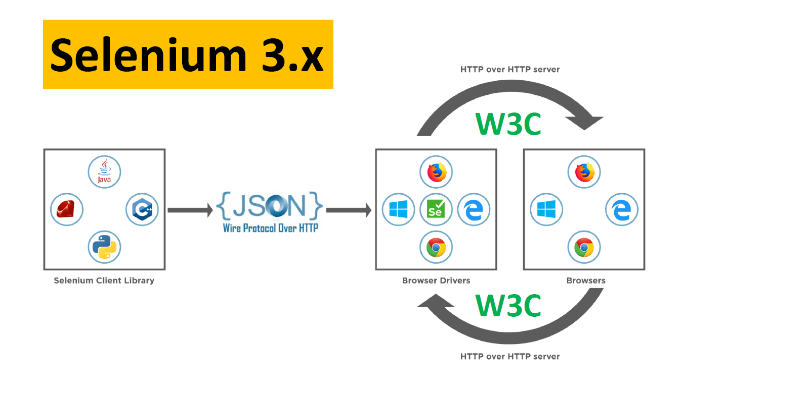
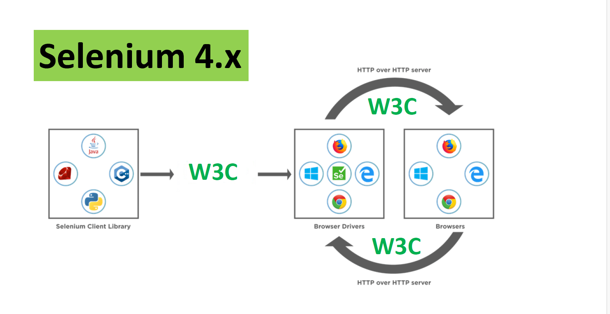

What is WebDriver?

-> WebDriver is One of the component in selenium.
-> WebDriver is module
- WebDriver is a browser automation interface commonly used with Selenium. 
- It lets you control browsers programmatically—opening pages, clicking buttons, entering text, 
- taking screenshots, and running automated tests.

firefox browser -----> Firefox()
Chrome Browser ---> Chrome()
Edge---> Edge()
--
---
---

-> WebDriver is an API (Application Programming Interface)

Architecture of WebDriver
-------------
Selenium3
-----
Selenium Language bindings--JSON Wire protocol---> Browser drivers---w3c--> Browsers

Selenium4
-----
Selenium Language bindings--w3c---> Browser drivers---w3c--> Browsers

