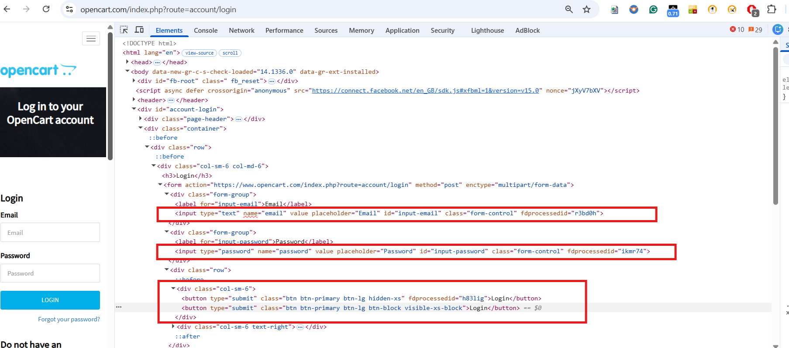

# Url for Example- https://www.opencart.com/index.php?route=account/login

# Customer locators

# CSS_SELECTOR
Find an element using a CSS selector.

# 1 By Tag and ID:

driver.find_element(By.CSS_SELECTOR, "#email")
OR
driver.find_element(By.CSS_SELECTOR,"input#email")

# 2 By Tag and class:

driver.find_element(By.CSS_SELECTOR, ".form-control")
OR
driver.find_elements(By.CSS_SELECTOR,"input.form-control")

# 3 By Tag and attribute:

driver.find_element(By.CSS_SELECTOR,"[name='email']")
OR
driver.find_element(By.CSS_SELECTOR, "input[name='email']")

# 4 Multiple conditions: By Tag and class and atrribute- 

driver.find_element(By.CSS_SELECTOR,"input.form-control[placeholder='Email']")

