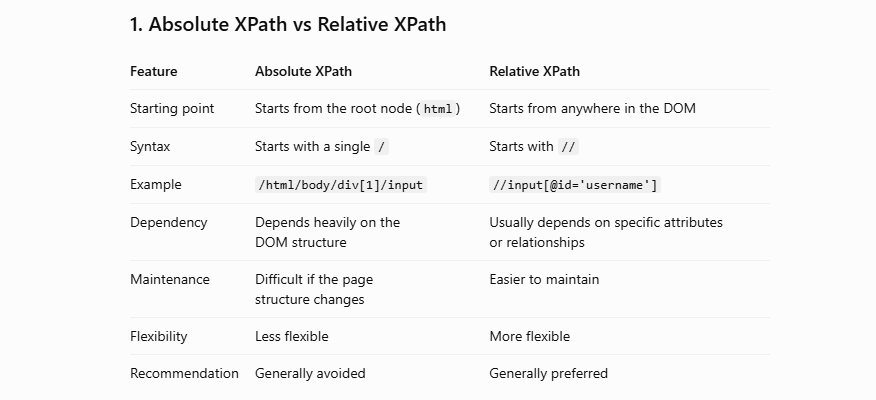

# Absolute xpath-- it's full xpath which can we write from Root to node element.

#url- https://www.opencart.com/index.php?route=account/login
#Example UserName- /html/body/div[2]/div[2]/div/div[1]/form/div[1]/input

#Example Password- /html/body/div[2]/div[2]/div/div[1]/form/div[2]/input

#Example Login- /html/body/div[2]/div[2]/div/div[1]/form/div[3]/div[1]/button[1]

# Relative xpath-
#url- https://www.opencart.com/index.php?route=account/login

#For Username- //input[@id='input-email']

#For Password- //input[@name='password']

#For login button- //button[@type='submit']

# Relative xpath- Xpath with and
#url- https://www.opencart.com/index.php?route=account/login

#For Username- //input[@id='input-email' and @name='email']

#For Password- //input[@name='password' and @name='password']

#For login button- //button[@type='submit' and @class='btn']

# Relative xpath- Xpath with or
#url- https://www.opencart.com/index.php?route=account/login

#For Username- //input[@id='input-email' or @name='email']

#For Password- //input[@name='password' or @name='password']

#For login button- //button[@type='submit' or @class='btn']

# Relative xpath with contains()- Xpath with contains()
#url- https://www.opencart.com/index.php?route=account/login

#For Username- //input[contains(@name,'em')]

#For Password- //input[contains(@id,'input-password')]

#For login button- //button[contains(@type,'submit')]

# Relative xpath with starts-with()- Xpath with starts-with()
#url- https://www.opencart.com/index.php?route=account/login

#For Username- //input[starts-with(@id,'input-email')]

#For Password- //input[starts-with(@id,'input-password')]

#For login button- //input[starts-with(@id,'input-password')]

# Relative xpath with text()- Xpath with text()
#url- https://www.opencart.com/index.php?route=account/login

#For Features link- //a[text()='Features']

# Difference between relative xpath and absolute xpath
