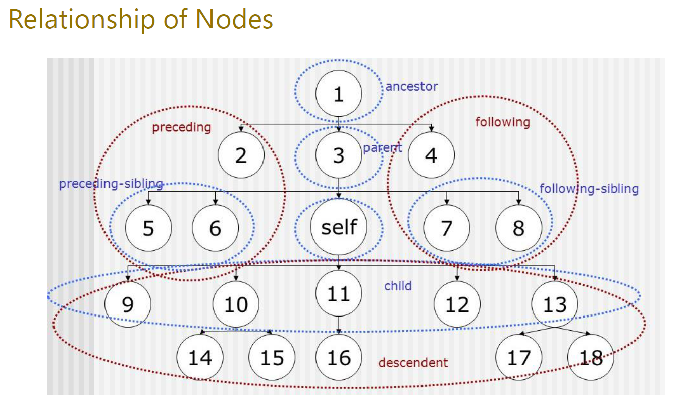
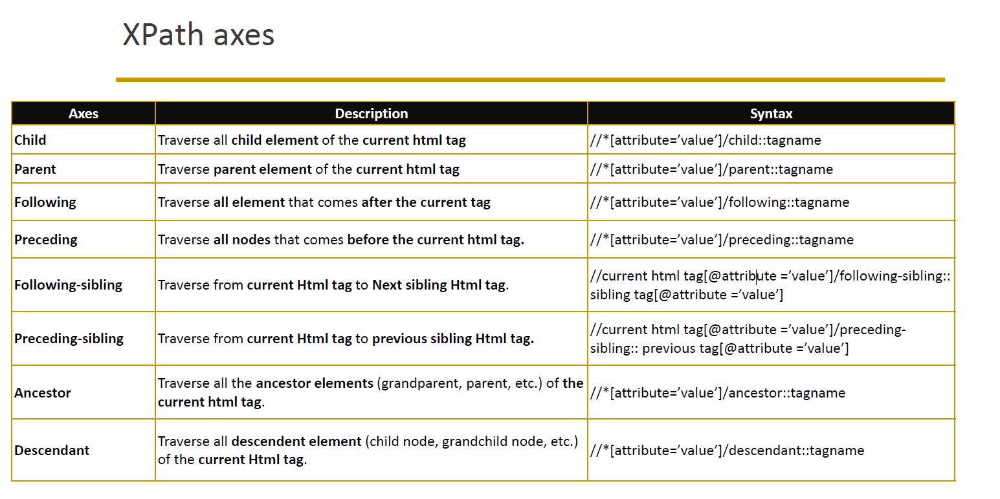

# XPath axes-

#1- XPath axes are those axes that are used to search for the multiple nodes in the XML document
from the current node context.

#2- These methods are mainly used when the web element is not identified with the help of ID,
name, class name, link text, CSS selector and XPath, etc. locators.

# XPath axes

# Url- "https://money.rediff.com/gainers/bse/daily/groupall"

# Self locator- //a[contains(text(),'VTM')]/self::a

# Parent locator- //a[contains(text(),'VTM')]/parent::td

# Child locator- //a[contains(text(),'VTM')]/ancestor::tr/child::td

# Ancestor locator- //a[contains(text(),'VTM')]/ancestor::tr

# Descendant locator- //a[contains(text(),'VTM')]/ancestor::tr/descendant::*

# Following locator- //a[contains(text(),'VTM')]/ancestor::tr/following::*

# Following-sibling locator- //a[contains(text(),'VTM')]/ancestor::tr/following-sibling::*

# Preceding locator- //a[contains(text(),'VTM')]/ancestor::tr/preceding::*

# Preceding-sibling locator- //a[contains(text(),'VTM')]/ancestor::tr/preceding-sibling::*

Note- if can not find exact locator of following-sibling or preceding-sibling then we can use (*), so it will capture all.
